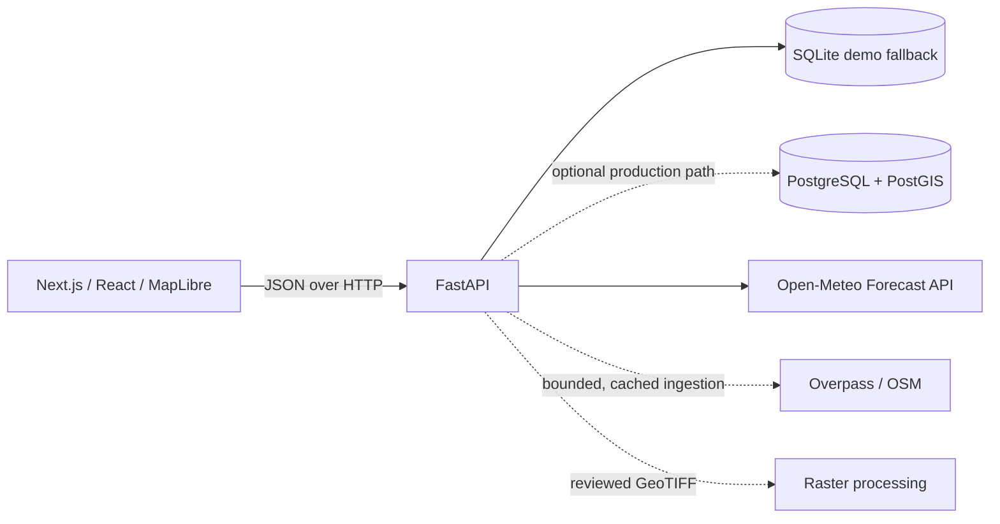

# Architecture

The frontend does not hold provider credentials. It renders a live map only when the public style service is reachable and otherwise shows an explicit fallback. The FastAPI API is modular by capability and returns provenance classification with each analytical output.

The default reliable MVP storage is a dependency-free SQLite demo fallback. When `DATABASE_URL` selects PostgreSQL, the API uses the `PostgresStore` adapter in `backend/app/storage.py`, applies the PostGIS migration at startup, persists geometries, and uses PostGIS geography queries such as `ST_DWithin` for exposure. SQLite uses a great-circle point-distance fallback and does not provide equivalent spatial capabilities. The adapter and migration are implemented, but live PostGIS initialization and spatial queries still need verification against a server with the PostGIS extension enabled.

